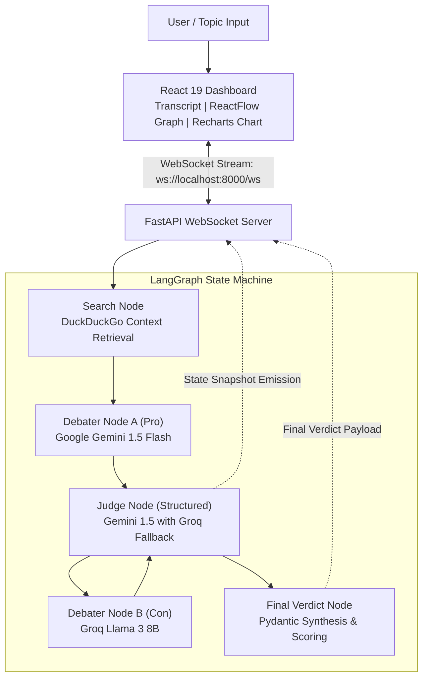

# Neural Arbiter

> Multi-agent adversarial AI debate engine orchestrating Google Gemini 1.5 Flash and Groq Llama 3 8B via LangGraph state machines, real-time DuckDuckGo context injection, structured Pydantic judge evaluation, and live WebSocket streaming to a React 19 / ReactFlow visual dashboard.  
> **Finalist — 5th place out of 700+ engineering teams at Microsoft Hack2Win.**

[](https://www.python.org/)
[](https://fastapi.tiangolo.com/)
[](https://python.langchain.com/docs/langgraph)
[](https://react.dev/)
[](https://www.typescriptlang.org/)
[](https://vite.dev/)
[](https://tailwindcss.com/)
[](LICENSE)

---

## Table of Contents

- [Overview & Motivation](#overview--motivation)
- [System Architecture](#system-architecture)
- [How It Works](#how-it-works)
  - [The Debater Agents](#the-debater-agents)
  - [The Pydantic-Validated Judge](#the-pydantic-validated-judge)
  - [Real-Time WebSocket Streaming](#real-time-websocket-streaming)
- [Interactive Mock Mode (TEST_MODE)](#interactive-mock-mode-test_mode)
- [Tech Stack](#tech-stack)
- [Project Structure](#project-structure)
- [Getting Started](#getting-started)
  - [Prerequisites](#prerequisites)
  - [Backend Setup](#backend-setup)
  - [Frontend Setup](#frontend-setup)
- [Environment Variables](#environment-variables)
- [Visual Dashboard Features](#visual-dashboard-features)
- [Screenshots & Visuals](#screenshots--visuals)
- [Roadmap](#roadmap)
- [Author](#author)
- [License](#license)

---

## Overview & Motivation

Information on controversial, nuanced topics is often fragmented and polarized. Neural Arbiter turns polarized queries into a structured adversarial inquiry:
1. **Agent A (Pro)** formulates a defensible case grounded in live search facts.
2. **Agent B (Con)** dissects Agent A's arguments, identifies weaknesses, and counter-attacks.
3. **Impartial Judge Agent** scrutinizes each exchange after every round, scoring credibility (0–100), detecting logical fallacies (e.g., ad hominem, straw man, false equivalence), detecting bias, and outputting academic synthesis.
4. **Interactive Dashboard** visualizes argument topologies using interactive node graphs (`@xyflow/react`) and live credibility tracking (`recharts`).

---

## System Architecture



---

## How It Works

### The Debater Agents

- **Agent A (Google Gemini 1.5 Flash):** Assumes the affirmative stance on the selected topic. Grounded by real-time DuckDuckGo search context fetched at the start of each round. Prompted for rigorous, evidence-based academic reasoning without rhetorical filler.
- **Agent B (Groq Llama 3 8B):** Assumes the opposing stance. Receives the full conversation history and search context, directly attacking Agent A's premise before advancing its own counter-argument.

### The Pydantic-Validated Judge

The Judge role processes every exchange through a strict Pydantic model (`DebateState` / `JudgeVerdict`), enforcing typed JSON output:
- **Credibility Scores (0–100)**: Independent quantitative scoring for both agents per round.
- **Fallacy Detection**: Explicit identification of argumentation flaws (e.g., cherry-picking, appeal to emotion).
- **Bias Analysis**: Identifies one-sided language or unverified assertions.
- **Model Redundancy**: If Gemini encounters quota or rate limit thresholds, the pipeline automatically falls back to Groq Llama 3 to preserve session completion.

### Real-Time WebSocket Streaming

Rather than waiting for the entire multi-round debate to finish (which can take 30–60 seconds), the FastAPI server streams each LangGraph node delta over a persistent WebSocket connection. As soon as a node completes its round, the React frontend updates its transcript and argument topology immediately.

---

## Interactive Mock Mode (TEST_MODE)

Neural Arbiter includes a built-in development simulation runner (`TEST_MODE=true` in `backend/config.py`).
- **No API keys needed**: Test and explore the full system locally out of the box.
- **Full simulation**: Generates realistic multi-turn agent exchanges, simulated DuckDuckGo research context, mock fallacy detection, and dynamic credibility scoring.
- **Zero quota consumption**: Ideal for UI design, demonstrations, and offline testing.

To enable live LLMs, set `TEST_MODE=false` in `.env` and provide your Google Gemini and Groq API keys.

---

## Tech Stack

| Layer | Technology | Version | Purpose |
|---|---|:---:|---|
| **Backend Framework** | FastAPI | `^0.115` | Async REST & WebSocket server |
| **Agent Orchestration** | LangGraph & LangChain | `^0.2` | Cyclical multi-agent graph state machine |
| **Primary LLMs** | Google Gemini 1.5 Flash | `langchain-google-genai` | Agent A (Pro) & Primary Judge |
| **High-Speed Inference** | Groq Llama 3 8B | `langchain-groq` | Agent B (Con) & Automated Fallback Judge |
| **Web Research** | DuckDuckGo Search | `duckduckgo-search` | Live context injection |
| **Frontend Framework** | React | `19.2.4` | Modern UI layer with React Server/Client paradigms |
| **Build & Tooling** | Vite | `8.0.1` | Ultra-fast development server & bundler |
| **Language** | TypeScript | `~5.9.3` | Type-safe client development |
| **Styling** | Tailwind CSS | `v4.2.2` | Utility-first responsive styling |
| **Graph Visualization** | `@xyflow/react` (React Flow) | `^12.10.2` | Interactive node-edge debate argument mapping |
| **Data Visualization** | Recharts | `^3.8.1` | Real-time agent credibility score line charts |

---

## Project Structure

```text
neural-arbiter/
├── backend/
│   ├── nodes/                 # LangGraph node implementations
│   ├── config.py              # Configuration, environment parsing & TEST_MODE toggle
│   ├── debater_node.py        # Pro and Con debater prompts and LLM invocation
│   ├── graph.py               # LangGraph cyclical state machine definition
│   ├── judge_node.py          # Impartial evaluator and Pydantic schema validation
│   ├── main.py                # FastAPI app, WebSocket endpoint (/ws) & static routing
│   ├── models.py              # Pydantic data schemas for messages and judge reports
│   ├── requirements.txt       # Python dependencies
│   ├── search_node.py         # DuckDuckGo query builder and snippet summarizer
│   └── .env.example           # Backend environment configuration template
├── frontend/
│   ├── src/
│   │   ├── components/        # Transcript, Argument Graph, and Chart panels
│   │   ├── App.tsx            # Main application layout and WebSocket hook
│   │   └── main.tsx
│   ├── package.json           # React 19 dependencies and scripts
│   ├── vite.config.ts         # Vite bundler configuration
│   └── tsconfig.json          # TypeScript compilation settings
├── .env.example               # Root configuration template
└── LICENSE                    # MIT License
```

---

## Getting Started

### Prerequisites

- **Python**: 3.10, 3.11, or 3.12 installed.
- **Node.js**: v18+ and npm installed.
- **Git** installed.

---

### Backend Setup

1. Clone the repository and navigate into the backend folder:
   ```powershell
   git clone https://github.com/Rohit-hub-coder/neural-arbiter.git
   cd neural-arbiter\backend
   ```

2. Create and activate a Python virtual environment:
   ```powershell
   # Windows (PowerShell)
   python -m venv venv
   .\venv\Scripts\Activate.ps1
   ```

3. Install required Python packages:
   ```powershell
   pip install -r requirements.txt
   ```

4. Configure your environment (Mock mode active by default):
   ```powershell
   Copy-Item .env.example .env
   ```
   *(Keep `TEST_MODE=true` to test immediately without API keys, or set to `false` and add your keys).*

5. Start the FastAPI server:
   ```powershell
   uvicorn main:app --reload --port 8000
   ```
   Server runs at `http://localhost:8000`.

---

### Frontend Setup

1. In a separate terminal, navigate into the `frontend` folder:
   ```powershell
   cd neural-arbiter\frontend
   ```

2. Install dependencies:
   ```powershell
   npm install
   ```

3. Start the Vite development server:
   ```powershell
   npm run dev
   ```
   Open `http://localhost:5173` in your browser.

---

## Environment Variables

| Variable | Default | Description |
|---|---|---|
| `TEST_MODE` | `true` | When `true`, runs the simulated debate engine with zero API consumption |
| `GOOGLE_API_KEY` | *(empty)* | Google AI Studio API key for Gemini 1.5 Flash models |
| `GROQ_API_KEY` | *(empty)* | Groq Cloud API key for ultra-low latency Llama 3 8B inference |
| `ANTHROPIC_API_KEY` | *(empty)* | *(Optional)* Anthropic Claude API key |

---

## Visual Dashboard Features

The React 19 visual interface displays 4 coordinated real-time panels:
1. **Live Transcript Feed**: Color-coded, chronologically ordered turns showing Pro arguments, Con rebuttals, and Judge evaluations.
2. **Argument Flow Graph**: Built with `@xyflow/react`, mapping debate claims into connected nodes showing how arguments build or refute prior assertions.
3. **Credibility Telemetry**: Built with `recharts`, rendering dynamic line graphs tracking credibility scores (0–100) per round.
4. **Structured Final Verdict**: Card displaying overall winner, confidence metric, fallacies detected, and an objective academic synthesis.

---

## Screenshots & Visuals

*Visual artifacts to place under `docs/`:*

- `docs/dashboard-overview.png`: Full split-screen view showing debate transcript and node graph.
- `docs/argument-graph.png`: Detailed view of the ReactFlow argument connection graph.
- `docs/credibility-chart.png`: Recharts credibility score line chart over multiple debate rounds.
- `docs/verdict-card.png`: Final judge verdict panel and fallacy analysis.

---

## Roadmap

- [ ] **Custom Persona Injection**: Allow users to select specific debating personas (e.g., Economist vs. Environmentalist).
- [ ] **Multi-Model Support**: Expand support to local models via Ollama.
- [ ] **Voice Synthesis**: Audio narration of debate turns via Web Audio / ElevenLabs.
- [ ] **Export to PDF**: Generate formal academic debate summary reports.

---

## Author

**Rohit Kumar**  
Software Engineering Undergrad @ Delhi Technological University (DTU)  
- GitHub: [@Rohit-hub-coder](https://github.com/Rohit-hub-coder)  
- LinkedIn: [Rohit Kumar](https://linkedin.com/in/rohit-kumar-dtu)  
- Email: [dhimanrohit1003@gmail.com](mailto:dhimanrohit1003@gmail.com)

---

## License

This project is licensed under the [MIT License](LICENSE).
